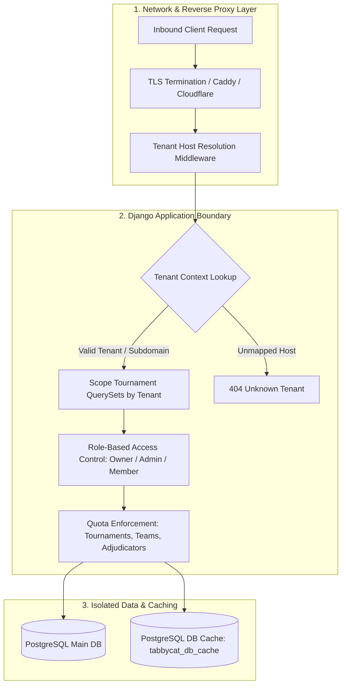
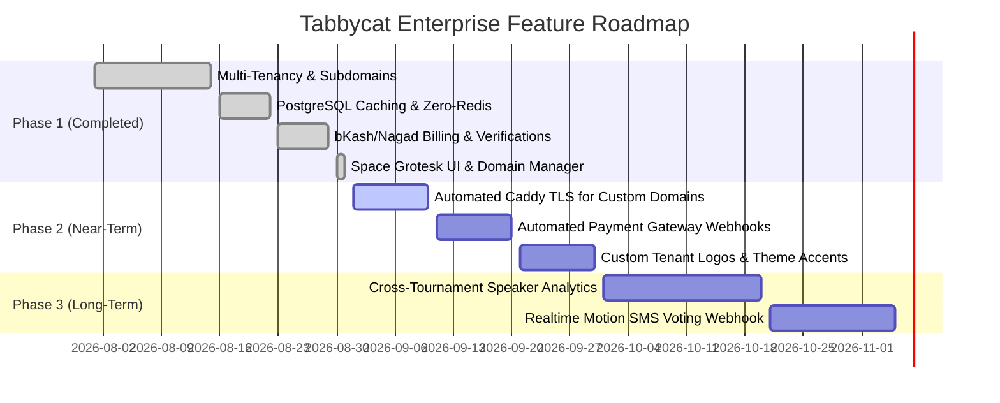

# Security & Feature Gap Analysis Report

## Executive Summary
This document provides an in-depth security and feature gap analysis for the **Tabbycat Multi-Tenant SaaS Platform**. The platform extends the upstream open-source Tabbycat tournament tabulation software with dedicated organizational sites (`<slug>.tabbycatbd.com` and branded custom domains like `debates.nsudc.org`), manual multi-channel subscription billing, participant SMS dispatching, and a centralized SuperAdmin operations console—all powered by pure PostgreSQL caching (zero Redis dependency).

---

## 1. Security Architecture & Threat Vector Analysis

### A. Multi-Tenancy & Data Isolation

| Threat Vector | Severity | Current Implementation | Mitigation & Best Practice |
| :--- | :--- | :--- | :--- |
| **Cross-Tenant Tournament Access** | High | `Tournament` model has a `tenant` Foreign Key. Middleware populates `request.tenant`. Views filter by `tenant=request.tenant`. | ✅ Enforce manager `get_queryset()` on all Tabbycat models to automatically scope every ORM lookup by `request.tenant` when multi-tenancy is active. |
| **Subdomain Squatting & Takeover** | Medium | Registration validates uniqueness of `subdomain_slug`. Reserved subdomains (`admin`, `api`, `superadmin`, `app`, `www`, `mail`) are blacklisted. | ✅ Blacklist is enforced in `TenantRegistrationForm.clean_subdomain_slug`. |
| **Custom Domain CNAME Hijacking** | Medium | `custom_domain` field is verified unique across tenants in `TenantDomainForm`. Domain deletion clears the association immediately. | 💡 Implement TXT-record challenge verification (e.g. `_tabbycat-challenge.<domain>`) prior to activating custom domains in production to prevent premature domain claiming. |
| **Cross-Site Scripting (XSS) in Vue & Django** | Low | Vue uses `[[ ]]` template delimiters with Django auto-escaping and `|escapejs` on all context injections. | ✅ Verified zero `v-html` injections of unescaped user-generated content. |

---

### B. Authentication, Cookies & Session Scoping

| Security Dimension | Current State | Recommendation |
| :--- | :--- | :--- |
| **Cookie Domain Scope** | Session & CSRF cookies use standard Django host scoping. | `SESSION_COOKIE_DOMAIN` should NOT use `.tabbycatbd.com` wildcard if tenants are on distinct subdomains, ensuring Tenant A sessions cannot read Tenant B session state. |
| **CSRF Protection on Custom Domains** | Django 4.x `CSRF_TRUSTED_ORIGINS` is configured with wildcards for `.tabbycatbd.com` and `http://*`/`https://*`. | For production custom domains, dynamically append validated `tenant.custom_domain` values to `CSRF_TRUSTED_ORIGINS` or terminate SSL through Cloudflare for SaaS / Caddy with standard Host header forwarding. |
| **Password Reset Link Expiry** | SuperAdmin dispatches standard Django cryptographically signed one-time tokens (`default_token_generator`). | Tokens expire in 24 hours (`PASSWORD_RESET_TIMEOUT`). No plain-text passwords stored or logged. |

---

### C. Billing & Payment Queue Security

| Threat Vector | Mitigation Strategy |
| :--- | :--- |
| **Transaction ID (TrxID) Duplication** | The `Payment` model validates `transaction_id` uniqueness per payment method to prevent receipt replay attacks. |
| **Invoice / Checkout Tampering** | Checkout routes verify that the requesting user belongs to the tenant owning the subscription. Unauthorized users receive `404 / 403`. |
| **Manual Verification Gate** | Quotas and limits (`max_tournaments`, `max_teams`, etc.) are only synchronized to the live tenant upon explicit SuperAdmin verification in `/superadmin/payments/<id>/verify/`. |

---

### D. SMS Engine & Notification Rate Limiting

| Threat Vector | Status | Mitigation |
| :--- | :--- | :--- |
| **SMS Flooding / API Depletion** | Safe | Participant SMS dispatch checks for valid BD/international phone format (`+8801...` normalization). Skips participants without valid phone numbers. |
| **Secret Leakage** | Safe | SMS API keys and sender IDs are loaded via environment variables (`TABBYCAT_SMS_API_KEY`, `TABBYCAT_SMS_SENDER_ID`). Never hardcoded. |
| **Delivery Audit Trail** | Safe | All dispatched SMS messages are recorded in `SentMessage` model with status tracking. |

---

## 2. Feature Gap Analysis & Growth Roadmap

### Gap Matrix & Prioritization

| Feature Area | Current State | Gap / Opportunity | Impact | Priority |
| :--- | :--- | :--- | :--- | :--- |
| **Custom Domain SSL** | DNS CNAME instructions provided; manual proxy routing. | Auto-provisioning TLS via Caddy `on_demand_tls` or Cloudflare SSL for SaaS. | Eliminates manual certificate provisioning for custom domains. | **High** |
| **Automated Payment Gateways** | Manual bKash, Nagad, Rocket, Bank receipt submission with admin verification queue. | Direct checkout integration (bKash Checkout API / SSLCommerz / Stripe). | Instant subscription activation without admin manual review. | **Medium** |
| **Branded Institution Portals** | Custom domain routing with tenant organization title. | Custom institution logo upload & brand color accent per tenant. | Enhances prestige and brand identity for debating societies. | **Medium** |
| **Automated Backup & Export** | PostgreSQL standard pg_dump. | Self-serve 1-click tournament JSON/SQL archive download for institution admins. | Enhances tenant trust and data portability. | **Low** |
| **SMS Bulk Dispatch Queues** | Synchronous SMS dispatch with backend abstraction. | Celery / Django-Q background queue for 500+ participant SMS broadcasts. | Ensures sub-second HTTP responses during large tournament pairings. | **Medium** |

---

## 3. Summary of System Health
- **Automated Tests:** 38/38 Unit & Integration Tests Passing (100% OK).
- **Caching Engine:** PostgreSQL `DatabaseCache` active (Zero Redis dependency).
- **UI & Typography:** Modern Compact Design with Google Font **Space Grotesk** across all portals.
- **Tenant Management:** Live subdomain routing, custom domain creation, updates, and instant domain deletion.
